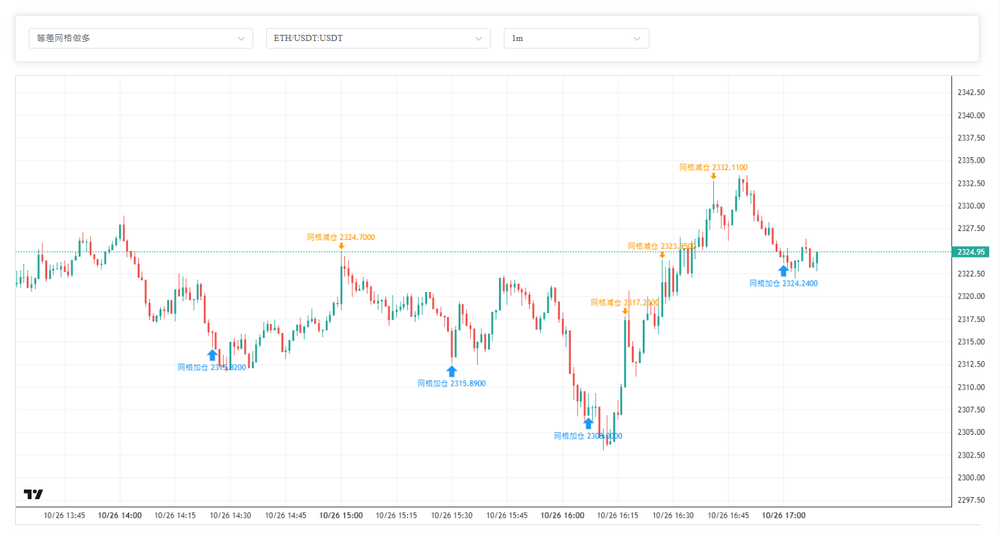

<div align="center">

# NexusBot

**面向 Freqtrade 的多实例量化交易控制台**

用一个 Web 界面管理多个交易机器人：配置策略、运行回测、监控持仓、追踪交易事件，并执行统一风控。


[快速了解](#nexusbot-是什么) · [功能预览](#-功能预览) · [核心能力](#核心能力) · [开始使用](#开始使用)

</div>

---

## NexusBot 是什么

Freqtrade 负责执行交易策略，NexusBot 负责把多个 Freqtrade 实例组织起来，让策略从“写好并运行”变成一个更容易使用的完整工作流：

```text
配置策略 → 准备数据 → 回测验证 → 启动机器人 → 实时监控 → 复盘与调整
```

它适合希望使用 Web 界面管理量化交易的个人用户和小型团队，尤其适合同时运行多策略、多交易对或多空方向的场景。

### NexusBot 可以帮你解决什么

- 不再为每个机器人手动维护配置文件、端口和启动命令；
- 不再在多个终端和日志文件之间切换查看持仓；
- 不再只看最终收益，可以在 K 线上复盘每次加仓、减仓和退出；
- 不再让回测参数与运行参数分离，保存的配置可以直接用于回测和启动；
- 不再只依赖单笔交易止损，可以按机器人整体收益执行止盈、止损和追踪止损。

> NexusBot 是交易管理工具，不承诺收益，也不构成投资建议。接入真实账户前，请先使用 `dry_run`，并自行验证策略、手续费、滑点和交易所配置。

## 🎬 功能预览

### 📹 视频演示

[](https://www.bilibili.com/video/xxxxx)

> 演示流程：登录 → 选择策略 → 查看实时 K 线 → 复盘交易事件 → 调整参数 → 发起回测。

### 📸 界面截图

#### 实时 K 线与交易事件



K 线上集中展示信号开仓、DCA 加仓、趋势加仓、网格减仓、止盈、止损和全局平仓等事件。你可以直接看到机器人为什么在某个时间点调整仓位，而不必从长日志中人工还原交易过程。

#### 策略配置面板


通过表单配置交易方向、指标、DCA、网格、趋势加仓、止盈止损和 ROI 阶梯。保存后由 NexusBot 自动生成对应实例的 Freqtrade 配置，无需手动编辑复杂 JSON。

#### 实时持仓监控


在一个仪表盘中查看多个 bot 的持仓、方向、盈亏、杠杆和保证金，并按 bot、方向或交易对筛选。

#### 回测结果


使用当前策略配置发起回测，查看收益、回撤、胜率、盈亏比和退出原因，再决定是否启动模拟盘或真实交易实例。

## 核心能力

### 多实例管理

每个 bot 都是独立的运行单元，可以单独配置、启动、停止、重启和查看状态。一个 bot 可以按需启用 Long、Short，两个方向使用独立的 Freqtrade 进程：

```text
Bot #N
├── Long  → 独立端口 → 独立配置 → 独立数据库与日志
└── Short → 独立端口 → 独立配置 → 独立数据库与日志
```

- 实例之间互不覆盖，适合运行多个策略和参数组合；
- 配置、日志、交易记录按 bot 隔离；
- 启动后自动检查 Freqtrade RPC 是否可用；
- 支持后台启动、状态查询、方向重启和健康监控；
- 可按交易所账户、交易对、资金和杠杆创建不同 bot。

### 参数可配置化

策略参数通过 Web 表单统一管理，并保存为可复用的 bot 配置：

| 配置范围 | 可配置内容 |
| --- | --- |
| 交易基础 | 交易对、资金、单笔金额、杠杆、最大持仓、模拟盘 |
| 入场指标 | MACD、KDJ、EMA、RSI、布林带及组合条件 |
| 仓位管理 | DCA 分层、网格加减仓、趋势加仓、金额/百分比模式 |
| 退出规则 | ROI 阶梯、止损、浮亏止盈、时间止损 |
| 行情保护 | 高周期趋势过滤、Pump 保护、单交易对仓位上限 |
| 实例风控 | bot 级止盈、止损、追踪止损和触发后自动停止 |

配置流程：

```text
Web 表单 → 保存参数 → 生成 bot/方向配置 → 回测 → 启动实例
```

### DCA、网格与趋势加仓

NexusBot 内置的策略框架支持多种仓位管理方式组合使用：

- **DCA**：按价格偏移分层补仓，支持最大次数、金额倍率和冷却时间；
- **网格**：设置上下边界，自动执行网格加仓和减仓；
- **趋势加仓**：结合 MACD、KDJ、EMA 判断趋势延续；
- **多级止盈**：支持 ROI 阶梯、浮亏反弹止盈和时间止损；
- **高周期过滤**：支持 4h、12h、1d 趋势保护，减少逆势开仓和加仓。

### 回测与数据准备

回测和历史数据下载由 NexusBot 统一管理：

- 检查本地 K 线是否覆盖交易对、周期和时间范围；
- 缺少数据时触发下载，并显示任务进度；
- 后台执行 Freqtrade，不阻塞 Web 请求；
- 支持查询、取消和查看任务日志；
- 对配置错误、数据缺失、进程异常和无回测报告明确提示；
- 使用与机器人相同的配置，减少回测与实际运行之间的偏差。

### 实时监控与交易复盘

- 汇总多个 bot 的账户、持仓、已平仓收益和浮动收益；
- 查看资金曲线、收益曲线、保证金和风险暴露；
- 按 bot、方向和交易对筛选持仓；
- 支持手动开仓、平仓以及机器人启停；
- 将交易事件保存并映射到 K 线，方便定位每次策略动作。

### 统一风控

风控以 bot 为单位计算“轮次收益”，同时考虑已实现收益和浮动收益：

- 按金额或收益率触发止盈、止损；
- 支持盈利回撤和亏损方向的追踪止损；
- 触发后执行全量平仓，并等待持仓确认清空；
- 可按配置自动停止 bot；
- 避免同一个风控条件重复触发。

## 工作方式

```text
┌────────────────────┐
│  Vue Web 控制台     │  配置 / 仪表盘 / K线 / 回测
└─────────┬──────────┘
          │ REST API
┌─────────▼──────────┐
│  FastAPI 管理服务   │  bot / 配置 / 回测 / 风控 / 监控
└────┬──────────┬────┘
     │          │
┌────▼─────┐ ┌──▼──────────────────┐
│ 本地数据 │ │ Freqtrade 实例池    │
│ 用户/事件│ │ 每个 bot × 方向独立 │
└──────────┘ └────────────────────┘
```

NexusBot 使用 Vue 3、FastAPI、SQLite、SQLAlchemy、APScheduler 和 Freqtrade 构建。它不替换 Freqtrade 的交易执行能力，而是提供配置、编排、观测和风控层。

## 开始使用

### 环境要求

- Python 3.10+
- Node.js 18+
- npm 或 pnpm
- 可用的 Freqtrade 运行环境
- 回测所需的交易所历史 K 线数据

### 启动后端

```powershell
python -m venv venv
.\venv\Scripts\Activate.ps1

# 按运行环境安装 FastAPI、Freqtrade、SQLAlchemy、Pandas、TA-Lib 等依赖
cd backend
uvicorn app.main:app --reload --port 9000
```

### 启动前端

```powershell
cd frontend
pnpm install
pnpm dev
```

打开 `http://localhost:5173`，创建 bot 后配置交易对、方向、资金和策略参数。建议先使用 `dry_run`，完成回测和模拟盘验证后再接入真实账户。

> API Key、Secret、JWT Secret 等敏感配置不应提交到 Git。部署时请根据实际环境调整 `config_template.json` 和运行路径。

## 项目结构

```text
NexusBot/
├── backend/
│   ├── app/api/                 # bot、回测、图表、持仓、风控、日志接口
│   ├── app/services/            # 实例、进程、配置、回测、RPC、风控服务
│   ├── app/models/              # 用户、交易事件、收益和资金快照
│   └── config/settings.py       # 项目路径与运行配置
├── frontend/src/
│   ├── features/                # dashboard、策略配置等功能模块
│   ├── views/                   # 仪表盘、持仓、图表、bot 和设置页面
│   ├── api/                    # 后端接口封装
│   └── stores/                 # Pinia 状态管理
└── freqtrade/user_data/
    ├── strategies/              # 多空策略基类、方向策略和事件记录器
    ├── bots/{bot_id}/           # 实例配置、日志和交易数据库
    └── config_template.json     # Freqtrade 配置模板
```

## 免责声明

NexusBot 仅用于软件工程实践、量化研究和学习交流，不保证任何收益，也不构成投资建议。加密货币交易具有高风险，使用者应自行承担 API Key、资金、策略和交易风险。

如果 NexusBot 对你有帮助，欢迎点一个 Star，并通过 Issue 分享使用反馈。
